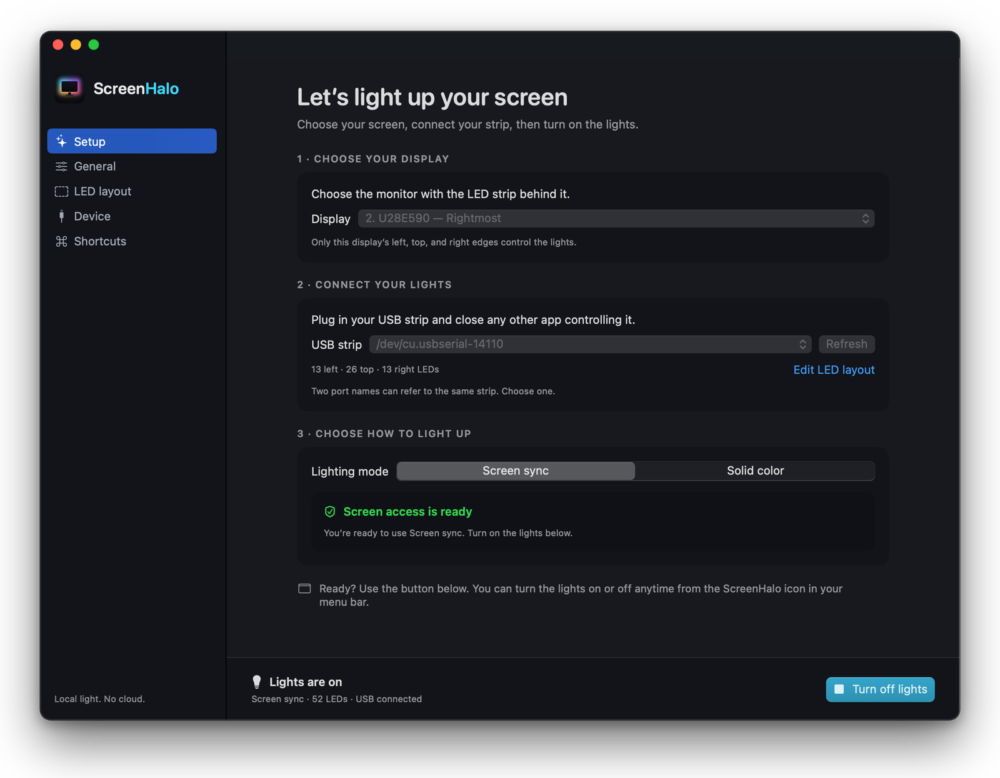

# ScreenHalo

Ambient light for your Mac display. ScreenHalo is a free, open-source menu bar app that sends colors from your selected screen to a compatible USB LED strip.

Built with SwiftUI and AppKit. Screen capture and color processing run locally, with no account, telemetry, cloud service, or network access in the app.

[Website](https://screenhalo.si/) · [Releases](https://github.com/ArneKorsika/ScreenHalo/releases) · [Report an issue](https://github.com/ArneKorsika/ScreenHalo/issues)



## Download

Download **ScreenHalo.zip** from the [latest release](https://github.com/ArneKorsika/ScreenHalo/releases/latest), unzip it, and drag **ScreenHalo.app** into Applications. Choose the app attachment rather than GitHub’s automatically generated source-code ZIP.

You do not need Xcode or Command Line Tools to run the packaged app.

- Requires macOS 14 Sonoma or later.
- The current packaged build is Intel-only. An Apple silicon build is not included. Running the Intel build on Apple silicon requires Rosetta and has not been verified here.
- The v0.1.1 release is signed with a Developer ID certificate and notarized by Apple. Older releases may still require **System Settings → Privacy & Security → Open Anyway**.

## Set up your lights

1. Plug in your compatible USB strip and close Skydimo or any other app controlling it.
2. Open ScreenHalo. On first launch, **Setup** helps you choose the monitor with the strip behind it and its USB serial port. Two port names can refer to the same adapter; choose one.
3. Confirm your layout under **LED layout**. The defaults are **13 left, 26 top, and 13 right**. The bottom edge is not sampled. Choose the cable start direction that matches your strip.
4. Select **Screen sync** or **Solid color**. For Screen sync, click **Allow screen access** and follow the macOS prompt. If needed, enable ScreenHalo under **Privacy & Security → Screen & System Audio Recording**, return, and click **Check access**. Quit and reopen if macOS asks or access still appears unavailable.
5. Click **Turn on lights**. The power button stays visible at the bottom of the settings window. You can also control the lights from the menu bar.

Solid color needs no screen permission. While Screen sync is active, macOS shows its screen-capture indicator. Closing settings leaves the app running; choose **Quit ScreenHalo** or press **⌘Q** while the app is active to exit.

## Try Screen sync

Turn on **Screen sync**, then play one of these videos full screen on the display selected in ScreenHalo:

- [Ambient lighting demo 1](https://www.youtube.com/watch?v=8u4UzzJZAUg)
- [Ambient lighting demo 2](https://www.youtube.com/watch?v=qC0vDKVPCrw)

You can also try other ambient-light videos on YouTube. Look for moving colors along the left, top, and right edges: the matching LEDs should follow those colors. Make sure the video is playing on your selected display.

These links open YouTube in your browser. The videos require an internet connection; ScreenHalo processes screen colors locally.

## Features

- Screen sync for one selected display, with the selection saved across launches.
- Separate left, top, and right LED regions, editable side counts, and reversible wire direction.
- Solid colors, presets, brightness, and adjustable smoothing.
- A menu bar popover, native settings, and configurable global keyboard shortcuts.
- Optional launch at login, lights on at launch, and pause/resume for display sleep and screen locking.
- Adjustable 30, 40, or 60 fps capture, limited by the configured strip’s serial bandwidth, and edge sampling depth from 2% to 30%.
- A red, green, and blue device test pattern and USB reconnect controls.

## Compatible hardware

ScreenHalo implements the **Skydimo serial protocol** at **115200 baud**, using RGB color order and **1–255 LEDs**. The strip should follow the left, top, and right edges of the monitor, starting at either bottom corner.

Compatibility depends on the controller’s firmware. A product using the Skydimo app, or a CH340 USB bridge, does not guarantee compatibility. Other protocols, Wi-Fi lights, audio-reactive lighting, and simultaneous control of multiple strips are not supported.

If your strip is not detected, check its cable, power, and macOS serial-driver support. No separate ScreenHalo driver is bundled.

## Privacy and performance

ScreenHalo captures a small image of the selected display, downscaled to 160 pixels on its longest side. It samples only the left, top, and right bands to calculate LED colors. Other displays are not combined into the capture.

Screen frames are processed in memory. No screen images or video are saved or uploaded, and audio is not captured. Preferences are saved locally. RGB colors are sent to the chosen USB device. The app is sandboxed with serial-device access and no network client or server entitlement. GitHub links open in your browser only when clicked.

Color rendering pauses once transitions settle. While the lights are on, a low-rate USB refresh resends the last colors so the controller stays active on static screens. This does not trigger extra screen capture or color calculations. The refresh stops when the lights are turned off or the app quits. macOS capture and WindowServer still consume resources; lower capture rates can reduce work. No fixed battery-life or CPU improvement is claimed.

## Keyboard shortcuts

| Action | Default |
| --- | --- |
| Lights on/off | ⌃⌥H |
| Switch lighting mode | ⌃⌥M |
| Brightness up | ⌃⌥↑ |
| Brightness down | ⌃⌥↓ |
| Next solid color | ⌃⌥C |

Change assignments in **Settings → Shortcuts**. Click a keycap group to record, press Escape to cancel, or clear an assignment. Opening the popover has no default global shortcut. **⌘,** opens settings and **⌘Q** quits while ScreenHalo is active.

## Troubleshooting

**The strip stays dark:** Check power, the selected USB port, brightness, and whether another app holds the device. Try Solid color first. If that works, check the selected display and screen permission for Screen sync. Protected video can appear black.

**Colors are mirrored or shifted:** Check the side counts and start direction in LED layout. The bottom edge does not contribute colors.

**Screen permission still appears denied:** Enable ScreenHalo in System Settings, return, and click Check access. Quit and reopen if necessary. Replacing an ad-hoc signed build can affect macOS’s stored permission identity.

**Your Mac feels slow while syncing:** Turn off the lights, open **Settings → General → Screen capture**, and lower **Update rate** and **Edge depth**. Try **30 fps** and **5–10%** depth, then turn the lights back on. A lower update rate captures less often; a smaller edge depth samples fewer pixels and makes the lights follow colors closer to the screen edges.

**A shortcut is unavailable:** Another app may already own that combination. Choose different keys or quit the other ScreenHalo instance.

## Build from source

Building requires Xcode or Apple’s Command Line Tools with a macOS SDK and Swift 5.9 or later. These tools are not required by people downloading the app.

```sh
./build.sh
open build/ScreenHalo.app
```

Open `Package.swift` in Xcode to edit the project. The build creates `build/ScreenHalo.app` and generates its icon locally. By default, it targets the build machine’s architecture and uses ad-hoc signing. Set `SCREENHALO_SIGN_IDENTITY` to an installed signing identity to use it instead. Signing alone does not notarize the app.

## Contributing

Everyone is more than welcome to contribute! Bug reports, ideas, documentation improvements, and code contributions are all appreciated.

[Open an issue](https://github.com/ArneKorsika/ScreenHalo/issues) to report a problem or suggest an improvement, or send a pull request. If you’re planning a bigger change, start a discussion in an issue so we can work out the details together.

## License and credits

Copyright © 2026 Arne Korsika. Released under the [MIT License](LICENSE).

ScreenHalo is independently implemented. The Skydimo wire format was checked against [Hyperion’s Skydimo driver](https://github.com/hyperion-project/hyperion.ng/blob/master/libsrc/leddevice/dev_serial/LedDeviceSkydimo.cpp).

ScreenHalo is not affiliated with or endorsed by Skydimo. The name is used to describe protocol compatibility.
